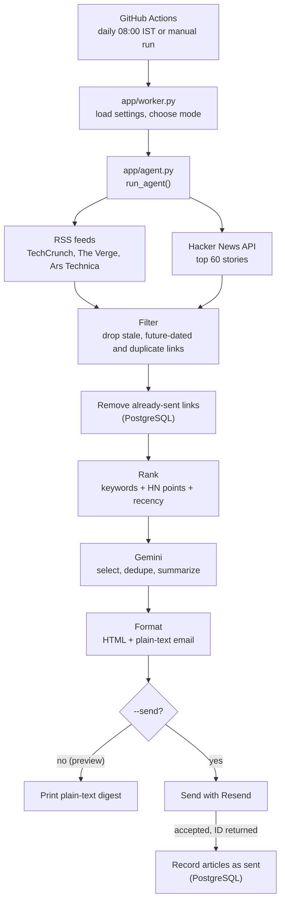

# Briefly (Python)

Briefly emails you a curated tech news digest every morning. It collects stories from RSS feeds and Hacker News, filters and ranks them, asks Gemini to pick the best ones and summarize them, and sends the result through Resend. It runs on a GitHub Actions schedule, so there is no server to host.

This is the Python version of [Briefly](https://github.com/pritamahanta/Briefly), which is written in Node.js. The pipeline, ranking, prompt and database schema are the same.

- **Automated:** runs daily at 8:00 AM IST (02:30 UTC) with GitHub Actions, or on demand.
- **No repeats:** every sent link is stored in PostgreSQL, so a story is never emailed twice.
- **Grounded summaries:** Gemini only sees titles and feed descriptions, and it can only return indices and summary text. Titles, links, sources and dates always come from the original records.
- **Safe to run:** preview mode sends nothing and records nothing, and tests need no credentials or network.

## Tech stack

| Area | Technology |
| --- | --- |
| Runtime | Python 3.13, asyncio |
| News sources | RSS via `feedparser`; Hacker News public API via `httpx` |
| AI | `google-genai` (Gemini) with a structured JSON response schema |
| Models and config | `pydantic`, `pydantic-settings` |
| Database | PostgreSQL (for example [Neon](https://neon.com)), accessed with `psycopg` 3 |
| Email | [Resend](https://resend.com) |
| Scheduling / CI | GitHub Actions |
| Tests | `pytest` |

## How it works



1. **Collect** (`app/services/news_fetcher.py`): RSS and Hacker News are fetched concurrently and normalized to one `Article` model.
   - RSS: three feeds, 10-second timeout, descriptions cleaned of HTML and capped at 300 characters.
   - Hacker News: the first 60 top-story IDs, at most 20 requests in flight (8-second timeout for the list, 5 seconds per story). Deleted, dead and non-story items are skipped, and so are items without an external URL, such as Ask HN. When a story has no text, the description is its points and comment count.
   - Links must be valid HTTP(S). Tracking parameters (`utm_*`, `fbclid`, `gclid`, `mc_cid`, `mc_eid`) and `#fragments` are stripped (`app/utils/url.py`).
   - A failed feed or story logs a warning and the rest continue. The run only fails if every source fails.
2. **Filter** (`app/utils/article_filter.py`): removes articles older than `MAX_ARTICLE_AGE_HOURS` or dated in the future, and removes duplicate links within the run. Undated articles are kept but get no recency bonus.
3. **Remove already-sent links** (`app/db.py`): looks up the SHA-256 hash of each link in the `articles` table and drops matches.
4. **Rank** (`app/utils/scorer.py`): scores each article (see [Ranking](#ranking)) and sorts highest first. Ties keep input order.
5. **Select and summarize** (`app/services/ai_service.py`): sends at most the top 30 candidates to Gemini (see [AI step](#ai-step)). Skipped when there are no candidates.
6. **Format** (`app/services/formatter.py`): builds the subject, an HTML email and a plain-text email.
7. **Send** (`app/services/email_service.py`): only with `--send`. Delivers through Resend and requires an accepted email ID.
8. **Record** (`app/db.py`): stores the selected articles, but only after Resend has accepted the email.

### Ranking

Each keyword group adds its weight once if a whole word or phrase matches the title or description.

| Keyword group | Weight |
| --- | --- |
| AI and machine learning | 10 |
| Developer tools and releases | 8 |
| Security and regulation | 7 |
| Startups and funding | 5 |
| Major tech companies | 4 |
| Cloud and infrastructure | 2 |

Hacker News points add `points / 100` (capped at 5). Recency adds up to 3 points, decreasing linearly to 0 over 12 hours. Scores are rounded to two decimals.

### AI step

- Input: up to 30 ranked candidates (`index`, title, description, source, score), plus the maximum number of stories.
- The model selects up to `TOP_ARTICLES_COUNT` stories, keeps one version of duplicate coverage, excludes opinion and promotional pieces unless clearly newsworthy, and writes 2-3 short sentences per story (one when little information is available).
- Output is requested as structured JSON (`{ "selected": [{ "index", "summary" }] }`) and validated: indices must be unique and in range, summaries must be non-empty and at most 1,200 characters, and the selection limit must hold. Any violation stops the run with an error.
- Candidate text is treated as data, never as instructions.
- Limits: 60-second timeout, up to 3 attempts per request (the original plus 2 retries), 4,096 output tokens.

### Email

`format_email()` returns `Email(subject, html, text)` with a dated subject and heading (IST, `Asia/Kolkata` offset), a story count, and numbered stories with source, summary and link. The HTML uses inline styles and a table layout for email clients. All text and link attributes are escaped, and links must be HTTP(S). An empty selection renders "No new stories today", but empty digests are never sent.

Resend accepting an email is not the same as inbox delivery.

### Data model

One table, created automatically on startup (`CREATE TABLE IF NOT EXISTS`):

| Column | Type | Notes |
| --- | --- | --- |
| `id` | `SERIAL` | Primary key |
| `title` | `TEXT` | |
| `link` | `TEXT` | Unique, original URL (case preserved) |
| `link_hash` | `CHAR(64)` | Unique, SHA-256 of the link, used for lookups |
| `source` | `TEXT` | For example `TechCrunch` or `Hacker News` |
| `published_at` | `TIMESTAMPTZ` | Nullable |
| `sent_at` | `TIMESTAMPTZ` | Defaults to `NOW()` |
| `score` | `NUMERIC(6,2)` | Ranking score at send time |

All queries are parameterized, and inserts use `ON CONFLICT (link_hash) DO NOTHING`. Each database call opens its own connection with a 5-second connect timeout.

## Project structure

```
.
├── .github/workflows/daily-digest.yml   # Schedule, tests, run agent
├── app/
│   ├── worker.py                        # CLI entry point: load settings, pick mode, report errors
│   ├── agent.py                         # run_agent(): the pipeline, with replaceable services for tests
│   ├── config.py                        # Settings and validation
│   ├── models.py                        # Article and AI response models
│   ├── db.py                            # PostgreSQL: schema, filter_unseen, mark_as_sent
│   ├── services/
│   │   ├── news_fetcher.py              # RSS + Hacker News collection and normalization
│   │   ├── ai_service.py                # Gemini selection and summaries, response validation
│   │   ├── formatter.py                 # HTML and plain-text email
│   │   └── email_service.py             # Resend delivery and settings validation
│   └── utils/
│       ├── article_filter.py            # Age filter and in-run deduplication
│       ├── scorer.py                    # Keyword, points and recency scoring
│       └── url.py                       # Link normalization and hashing
├── scripts/check_db.py                  # Integration check against a real database
├── tests/                               # pytest suite
├── .env.example
├── pytest.ini
└── requirements.txt
```

## Getting started

You need Python 3.13 (the version CI uses), a PostgreSQL database, a Gemini API key and a Resend API key.

1. **Install**

   ```bash
   git clone https://github.com/pritamahanta/briefly-py
   cd briefly-py
   python -m venv .venv
   source .venv/bin/activate      # Windows: .venv\Scripts\activate
   pip install -r requirements.txt
   cp .env.example .env
   ```

2. **Database:** create a project at [neon.com](https://neon.com) (or use any PostgreSQL) and paste its connection string into `DATABASE_URL`. Keep the `sslmode` setting from the connection string. The table is created on the first run.
3. **Gemini:** create a key in [Google AI Studio](https://aistudio.google.com/apikey) and set `AI_API_KEY`. Model access and quotas depend on your Google project.
4. **Resend:** create a key in [Resend](https://resend.com/api-keys) and set `RESEND_API_KEY`, `EMAIL_FROM` and `EMAIL_TO`. Resend's test sender (`onboarding@resend.dev`) can only send to your own Resend account email. To send to anyone else, verify a domain and use an address on it for `EMAIL_FROM`.
5. **Run**

   ```bash
   python -m app.worker           # preview: prints the digest, sends nothing, records nothing
   python -m app.worker --send    # sends the digest and records its articles as sent
   ```

   Preview mode still calls Gemini when there are candidates, so it uses a little API quota.

### Configuration

Values come from the environment. Locally they are read from `.env` and `.env.local` (`.env.local` wins); variables already set in the environment win over both.

| Variable | Default | Purpose |
| --- | --- | --- |
| `DATABASE_URL` | required | PostgreSQL connection string (must start with `postgres://` or `postgresql://`). |
| `AI_API_KEY` | required when there are candidates | Gemini API key. |
| `GEMINI_MODEL` | `gemini-3.5-flash-lite` | Gemini model for selection and summaries. |
| `RESEND_API_KEY` | required to send | Resend API key. |
| `EMAIL_FROM` | required to send | One sender email address. |
| `EMAIL_TO` | required to send | One recipient email address. |
| `MAX_ARTICLE_AGE_HOURS` | `25` | Maximum article age. Positive whole number. |
| `TOP_ARTICLES_COUNT` | `8` | Maximum stories per digest. Positive whole number. |

Invalid settings stop the program with exit code 1 and an error message. With `--send`, the email settings are validated before any news is fetched.

## Deployment (GitHub Actions)

The **Briefly** workflow (`.github/workflows/daily-digest.yml`) runs every day at 02:30 UTC (8:00 AM IST). It checks out the code, installs `requirements.txt`, runs `pytest`, then runs the agent. Runs are serialized so two digests can never overlap, and the job times out after 10 minutes.

1. Push the repository to GitHub.
2. Open **Settings → Secrets and variables → Actions** and add these secrets: `DATABASE_URL`, `AI_API_KEY`, `RESEND_API_KEY`, `EMAIL_FROM`, `EMAIL_TO`.
3. Optionally add the variables `GEMINI_MODEL`, `MAX_ARTICLE_AGE_HOURS` and `TOP_ARTICLES_COUNT`. Without them the defaults above apply.
4. Test once from **Actions → Briefly → Run workflow**. Leave `send_email` unchecked for a preview, or tick it to send a real email and record its articles.

Scheduled runs always send. GitHub schedules can start late, only run from the default branch, and are paused on public repositories after 60 days without repository activity.

## Development and testing

```bash
pytest                      # unit and pipeline tests with fake services: no credentials, no network, no email
python -m scripts.check_db  # checks your real database; uses its own test rows and deletes them
```

Run `check_db` as a module from the repository root. `python scripts/check_db.py` fails with `No module named 'app'`.

`run_agent()` accepts replacement services, which is how the tests exercise the whole pipeline without external calls.

## Design decisions

- **Record only after acceptance.** Articles are saved as sent only after Resend returns an email ID, so a failed send never hides a story. If the email is accepted but the database write fails, the error says so and tells you to check Resend before retrying.
- **The model cannot invent links.** Gemini returns only indices and summaries, and everything else is copied from the original records.
- **Untrusted input everywhere.** Feed content is escaped in HTML, links must be HTTP(S), and the prompt treats article text as data.
- **Partial failure tolerance.** One bad feed or story never stops a run. Total failure of all sources, the AI request, or the email send does.
- **No email retries in Briefly.** A retry after a timeout could send the same digest twice.

## Limitations

- Duplicates are detected by URL after tracking parameters are removed. The same story at different URLs (for example, two outlets covering it) can still appear twice, although Gemini is asked to keep one version of each story.
- Summaries come from titles and feed descriptions, so they can be thin for headline-only items.
- There is one recipient and a fixed list of RSS sources, defined in `app/services/news_fetcher.py`.
- Briefly sets no explicit timeout on the Resend call; the workflow's 10-minute job limit is the backstop.
